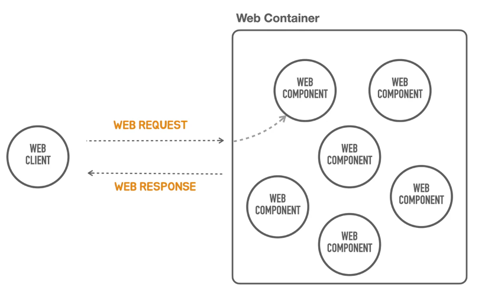
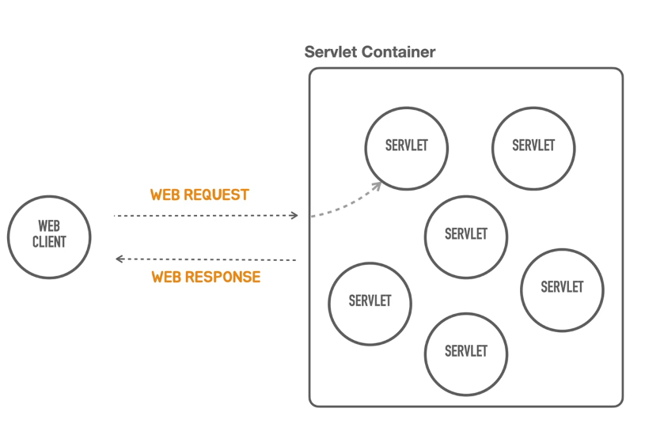
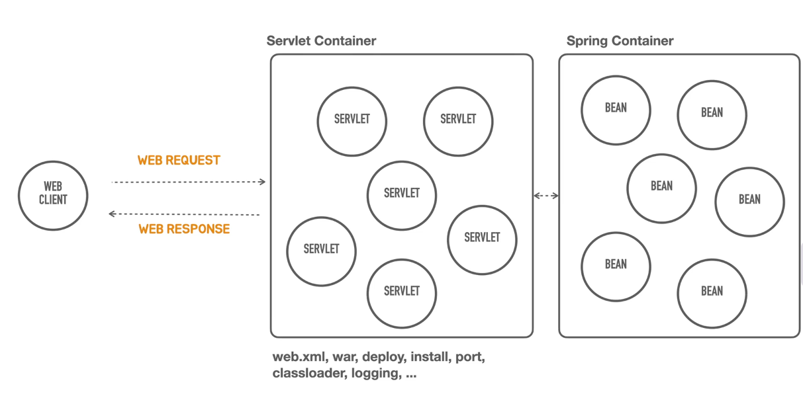
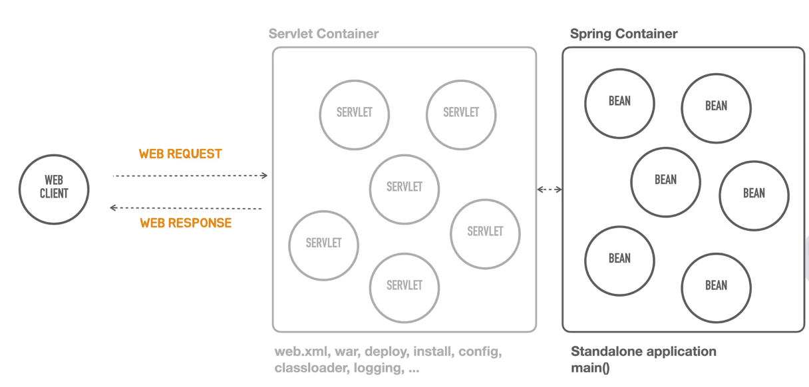

### SpringBoot란 무엇인가?
Spring을 기반으로 실무 환경에 사용 가능한 수준의 독립 실행형 애플리케이션을 복잡한 고민 없이 빠르게 작성할 수 있게 도와주는 여러가지 도구의 모음이다.

> 독립 실행형 애플리케이션이란 무엇?

SpringBoot의 목표
- 매우 빠르고 광범위한 영역의 스프링 개발 경험을 제공
- 강한 주장을 가지고 즉시 적용 가능한 기술 조합을 제공하면서 필요에 따라 원하는 방식으로 손쉽게 변형 가능
- 프로젝트에서 필요로 하는 다양한 비기능적인 기술(내장형 서버, 보안, 메트릭, 상태 체크, 외부 설정 방식) 제공
- 코드 생성이나 XML 설정을 필요로 하지 않음

# Containerless
컨테이너리스 웹 애플리케이션 아키텍처

여기서 말하는 컨테이너가 무엇인가?
스프링은 IoC 컨테이너임

이건 웹 프로그램으로 봤을때의 흐름임


위 그림을 자바 용어로 바꾼다면

이렇게 바뀐다

여기서 우리가 제일 잘아는 Tomcat도 Servlet Container의 일종이다.
위 그림은 Spring이 존재하지 않는 경우의 그림이고

이 그림은 Spring을 쓰는경우를 상징하는 그림이다

Servlet 컨테이너의 뒤쪽에 있으면서 서블릿 컨테이너의 서블릿을 통해서 요청이 들어온걸 가지고 스프링 컨테이너에게 넘겨 스프링 컨테이너의 빈들을 사용해 요청을 처리하는 것임

이때까지만 해도 Servlet 컨테이너의 설정(web.xml, war, deploy, install.. 등)이 여러 개 해줘야했음 -> 너무 귀찮은일 (한번  설정하면 쳐다볼일 그렇게 많지 않음)
그래서 이걸 해결하기 위해서 ContainerLess인 Spring boot를 사용하는것임
- 설정이 자동으로 매핑되서 Servlet에 닿게함
- 또한 Servlet Container의 설정을 깊이 다룰수 없는 것도 아님 -> 필요하다면 설정 커스텀 가능
-  즉 빈으로 등록만한다면 바로 웹 상에서 스프링 애플리케이션을 만들어 사용가능
    

##### 즉 여기서 말하는 컨테이너리스란 개발자가 서블릿 컨테이너의 설정에 신경을 쓰지 않아도 되는 것을 의미함

---
# Opinionated
####  Spring의 설계 철학
- 극단적 유연성 -> EJB보다 훨씬 유연함
- 다양한 관점을 수용
- Not opinionated
- 수많은 선택지를 다 포용
  -> Spring은 극단적으로 유연한 환경을 제공해주기 때문에 개발자들은 해당 어떻게 원하는 환경을 세팅할지 프로젝트 초기에 많은 시간 할애해야함
#### Spring boot의 설계 철학
- Opionionated
- 일단 정해주는 대로 빠르게 개발하고 고민은 나중에
    - Spring Boot는 검증된 스프링 생태계 프로젝트, 표준 자바 기술(버전), 라이브러리 등을 자동으로 제공해줌 -> ex. 나 JPA 쓸거야~ 하면 표준으로 설정해서 환경 바로 제공
    - Spring에 적용하는 방식(DI 구성)과 디폴트 설정값 제공
    - 즉 xml로 해당 사용 기술에 대한 세부 설정들을 안해줘도됨
- Spring을 잘 활용하는 뛰어난 방법 제공
##### 유연한 확장 가능
- Spring Boot에 내장된 디폴트 구성을 커스텀하는 매우 자연스럽고 유연한 방법 제공
- Spring Boot가 Spring을 사용하는 방식을 이해한다면 언제라도 Spring Boot를 제거하고 원하는 방식으로 재구성 가능
- Spring Boot처럼 기술과 구성을 간편하게 제공하는 나만의 모듈 작성

---
# HTTP
웹 Request와 Response의 기본 구조
#### Request
- Request Line: Method, Path, HTTP Version
- Headers
- Message Body
#### Response
- Status Line: HTTP Version, Status Code, Status Text
- Headers
- Message Body
```http
// Request
GET /hello?name=Spring HTTP/1.1
Accept: */*
Accept-Encoding: gzip, deflate
Connection: keep-alive
Host: localhost:8080
User-Agent: HTTPie/3.2.1

//Response
HTTP/1.1 200
Connection: keep-alive
Content-Length: 12
Content-Type: text/plain;charset=UTF-8
Date: Thu, 01 Dec 2022 01:45:15 GMT
Keep-Alive: timeout=60

Hello Spring
```